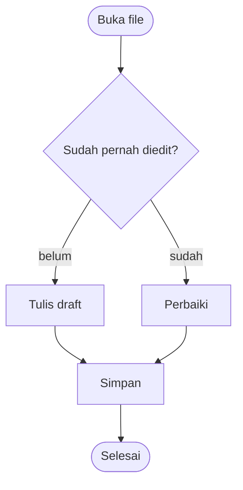

# Welcome to Markdown Studio

A complete **Markdown editor with live preview** that works entirely offline. No
internet, no account — you write on the left and see the finished page on the right.

> [!TIP]
> The keys are VS Code's. Press <kbd>Ctrl</kbd>+<kbd>Shift</kbd>+<kbd>P</kbd> (or <kbd>F1</kbd>)
> to search every command, <kbd>Ctrl</kbd>+<kbd>P</kbd> to jump to a file, and
> <kbd>Ctrl</kbd>+<kbd>,</kbd> for Settings. Lost this page? **⋮ menu → Welcome guide**
> opens the latest version of it.

## Quick start

1. Type in the left pane — the preview updates as you write
2. Use the toolbar or shortcuts like <kbd>Ctrl</kbd>+<kbd>B</kbd> for **bold**
3. Take a screenshot (<kbd>Win</kbd>+<kbd>Shift</kbd>+<kbd>S</kbd>) and press
   <kbd>Ctrl</kbd>+<kbd>V</kbd> in the editor — the picture goes in where the caret is
4. Open a whole folder with <kbd>Ctrl</kbd>+<kbd>K</kbd> <kbd>Ctrl</kbd>+<kbd>O</kbd><!-- exe -->, or
   right-click a `.md` file in Windows → **Open with** → **Markdown Studio**<!-- /exe -->
5. Press <kbd>Ctrl</kbd>+<kbd>S</kbd> to save

**This page has four parts.** The first is a tour of what the app does. The other
three are a working guide to writing a README: every example is live, so read the
result on the right and look at the same place on the left to see exactly how it was
typed. Delete any of it once you are done.

- [Part 0: Using Markdown Studio](#part-0-using-markdown-studio)
- [Part 1: The basics](#part-1-the-basics)
- [Part 2: Going further](#part-2-going-further)
- [Part 3: A README worth reading](#part-3-a-readme-worth-reading)

---

# Part 0: Using Markdown Studio

## Two kinds of document

The sidebar on the left has four panes, switched by the icons at its top.

| Pane | What is in it |
| ---- | ------------- |
| **Explorer** | A folder you opened, as a tree — every Markdown file in it, plus everything inside its `assets` folders |
<!-- exe -->
| **Docs** | Your own documents, each one a real `.md` file in your documents folder |
<!-- /exe -->
<!-- web -->
| **Docs** | Your own documents, kept in this browser |
<!-- /web -->
| **Outline** | The headings of the file you are in; click one to jump there |
| **Search** | Search every file in the opened folder at once |

<!-- exe -->
**Docs save themselves.** Each document in the Docs pane is a file in
`Documents\Markdown Studio`, written as you type. Rename it with the title box at the
top and its file is renamed too; delete it and the file goes to the Recycle Bin.
**Settings → Change folder…** moves them all somewhere else.
<!-- /exe -->
<!-- web -->
**Docs save themselves, in this browser.** They stay here between visits, but only in
this browser on this computer, and clearing its site data erases them. Press
<kbd>Ctrl</kbd>+<kbd>S</kbd> to save one as a real `.md` file, or **⋮ → Download
backup** to keep a copy of them all.
<!-- /web -->

**Files from a folder are saved by you**, like in VS Code. An edited file shows an
orange dot on its tab and in the tree, and the status bar says *Unsaved changes*
until you press <kbd>Ctrl</kbd>+<kbd>S</kbd> (<kbd>Ctrl</kbd>+<kbd>K</kbd> <kbd>S</kbd>
saves every open file). Closing a tab with unsaved changes asks first.

<!-- web -->
> [!NOTE]
> A folder opened from a page loaded straight off the disk (an address starting with
> `file://`) is **read-only**, and <kbd>Ctrl</kbd>+<kbd>S</kbd> downloads a copy instead.
> Serve the page from a local web server, such as laragon, to edit files in place.
<!-- /web -->

## Tabs

Every file you open gets a tab across the top. <kbd>Alt</kbd>+<kbd>1</kbd>–<kbd>9</kbd>
jumps to a tab, <kbd>Ctrl</kbd>+<kbd>PageDown</kbd>/<kbd>PageUp</kbd> steps through
them, a middle-click or <kbd>Ctrl</kbd>+<kbd>W</kbd> closes one,
<kbd>Ctrl</kbd>+<kbd>K</kbd> <kbd>Ctrl</kbd>+<kbd>W</kbd> closes them all and
<kbd>Ctrl</kbd>+<kbd>Shift</kbd>+<kbd>T</kbd> brings back the last one closed.
Right-click a tab for Close Others, Copy Tab, Copy Path and Rename.

**Move a tab** the way you would in Chrome: drag it along the bar and drop it where
you want it; the others make room as it passes. <kbd>Ctrl</kbd>+<kbd>Shift</kbd>+<kbd>PageUp</kbd>/<kbd>PageDown</kbd>
moves the current tab one place left or right, and <kbd>Esc</kbd> while dragging puts
everything back.

**Move where a document is stored** by dragging its tab off the bar:
- onto a **folder in the Explorer** — the file moves into that folder (onto a file, it
  goes into that file's folder). A Doc dropped there leaves Docs and becomes a file of
  that folder
- onto the **Docs** pane or its button — the file becomes a Doc

The folder you are over lights up and a label says where it will go; hold the tab over
a closed folder to open it, or over the Explorer or Docs button to switch to that pane.
The tab stays where it was on the bar and simply shows the file in its new place.
Pictures keep showing: their links are updated to the new place, and pictures from
another folder are copied along. If other documents linked to the file, you are asked
whether to update those links, as after a rename.
<!-- exe -->
The old file goes to the Recycle Bin.
<!-- /exe -->

**Copy a tab:** right-click it → **Copy Tab**, then right-click an empty part of the
tab bar → **Paste Tab**. You get a new tab with the same content, named "… (copy)".
It is a **new document saved in a new place**, not the same file — editing the copy
never changes the original:
<!-- exe -->
- the copy is a Doc, saved as its own `.md` file in the documents folder
  (`Documents\Markdown Studio`), and it is listed in the Docs pane
- pictures the original shows from its own `assets` folder are copied into the
  documents folder's `assets` too, and the copy's links point at them, so the
  pictures still show
<!-- /exe -->
<!-- web -->
- the copy is a Doc, kept in this browser's storage and listed in the Docs pane
- pictures the original shows from its folder are put into the copy's text, so they
  still show without that folder
<!-- /web -->

> [!NOTE]
> A few keys belong to the browser and never reach the page: <kbd>Ctrl</kbd>+<kbd>W</kbd>,
> <kbd>Ctrl</kbd>+<kbd>N</kbd>, <kbd>Ctrl</kbd>+<kbd>Tab</kbd> and
> <kbd>Ctrl</kbd>+<kbd>Shift</kbd>+<kbd>T</kbd> may close or open a window instead.
> Each has a second key that always works — <kbd>Ctrl</kbd>+<kbd>Alt</kbd>+<kbd>W</kbd>,
> <kbd>Alt</kbd>+<kbd>N</kbd>, <kbd>Ctrl</kbd>+<kbd>Alt</kbd>+<kbd>→</kbd> — listed on the
> shortcut sheet (<kbd>Ctrl</kbd>+<kbd>K</kbd> <kbd>Ctrl</kbd>+<kbd>S</kbd>).

## Right-click, rename and delete

Right-click a file in the Explorer for VS Code's menu: **Open**, **Reveal in File
Explorer**, **Copy Path**, **Copy Relative Path**, **Rename…** and **Delete**. Pictures
and other files in an `assets` folder have it too, plus **Insert into document**; a
folder has **New File…**; a document in the Docs pane and an editor tab have their own.

**Rename** happens right in the tree, the name selected up to its extension, as in
VS Code: type, then <kbd>Enter</kbd> to keep it or <kbd>Esc</kbd> to put it back. Click a
file once and <kbd>F2</kbd> renames it, <kbd>Delete</kbd> deletes it. When other
documents link to the file you renamed, you are asked whether to update those links —
including pictures, so `` follows `old.png` to its new name.

<!-- exe -->
**Delete** sends the file to the Recycle Bin, so a slip can be undone from there.
<!-- /exe -->
<!-- web -->
**Delete** in a folder opened in the browser removes the file for good — the browser
has no Recycle Bin to send it to — and says so before it does.
<!-- /web -->

## Pictures

**Paste a screenshot straight in**, the way Word takes one:

1. Press <kbd>Win</kbd>+<kbd>Shift</kbd>+<kbd>S</kbd> and select part of the screen
   (or copy any image)
2. Click in the editor where the picture should go
3. Press <kbd>Ctrl</kbd>+<kbd>V</kbd>

The picture is saved as a real file in an **`assets` folder next to the document**,
named after the document and the time, and a line like this goes in on its own:

````markdown

````

Then replace the word `image` with what the picture actually shows — see
[Links and images](#links-and-images) for why.

- **Drag image files** onto the window to do the same; they keep their own names
- A name that is already taken is **never overwritten** — the new picture gets a number
- Copying cells from Excel or text from Word still pastes the **text**, even though
  those programs put a picture on the clipboard too
- With no folder to save into (a document that lives only in the browser, or a
  read-only folder) the picture is **embedded** in the document instead: the place you
  pasted reads `![image][img-1]` and the picture data sits at the very end of the file
- **Export HTML** puts every picture inside the exported file, so it opens anywhere

| Where the document is | Where its pictures go |
| --------------------- | --------------------- |
| `D:\Project\notes.md` | `D:\Project\assets\` |
| `D:\Project\docs\api.md` | `D:\Project\docs\assets\` |
<!-- exe -->
| A document in the Docs pane | `Documents\Markdown Studio\assets\` |
<!-- /exe -->

> [!IMPORTANT]
> The link is relative, so a document and its `assets` folder belong together. Copy or
> move them as a pair and the pictures keep showing — in this app, in VS Code, and on
> GitHub.

## What is in `assets`

The Explorer lists **only Markdown files** — except inside a folder named `assets`,
where it shows **everything**, so you can see what is really in there.

| File | In the tree | Click it |
| ---- | ----------- | -------- |
| `.png` `.jpg` `.jpeg` `.gif` `.webp` `.bmp` `.svg` `.avif` `.ico` | picture icon | the picture, its size in pixels and on disk, and where it is |
| anything else (`.pdf`, `.docx`, `.zip`, ...) | file icon | its name and where it is |

From that window, **Copy path** copies where the file is, and **Insert into document**
writes the right link into the document you are editing — ``
from a subfolder, or `[spec.pdf](assets/spec.pdf)` for a file that is not a picture.
It is only offered when the document is in the same folder, because only then would
the link work.

<!-- exe -->
The **Docs** pane lists the library's own `assets` under your documents. Each one says
which document uses it, and one that **no document uses** is marked in orange — a
good sign it can be deleted.
<!-- /exe -->

Clicking a picture's link in the preview opens the same window.

## Finding things

| To | Press |
| -- | ----- |
| Jump to a file by name | <kbd>Ctrl</kbd>+<kbd>P</kbd> |
| Run any command | <kbd>Ctrl</kbd>+<kbd>Shift</kbd>+<kbd>P</kbd> or <kbd>F1</kbd> |
| Jump to a heading | <kbd>Ctrl</kbd>+<kbd>Shift</kbd>+<kbd>O</kbd>, or the **Outline** pane |
| Go to a line | <kbd>Ctrl</kbd>+<kbd>G</kbd> |
| Find / replace in this file | <kbd>Ctrl</kbd>+<kbd>F</kbd> / <kbd>Ctrl</kbd>+<kbd>H</kbd> |
| Search every file in the folder | <kbd>Ctrl</kbd>+<kbd>Shift</kbd>+<kbd>F</kbd> |

<kbd>Ctrl</kbd>+<kbd>P</kbd> takes the same prefixes as VS Code's: start with `>` for
commands, `@` for headings, `:` for a line number.

Find highlights every hit, outlines the current one and scrolls to it; <kbd>Enter</kbd>
steps through them. It has case-sensitive and regex modes, and works in the preview
too, against the text as it reads rather than the Markdown. Search in folder groups
the hits by file — click one to open the file at that exact line.

## Views

<kbd>Ctrl</kbd>+<kbd>1</kbd> editor only, <kbd>Ctrl</kbd>+<kbd>2</kbd> side by side,
<kbd>Ctrl</kbd>+<kbd>3</kbd> preview only. Switching keeps your place. Drag the bar
between the panes to resize them, double-click it to centre it again.

Side by side, the two panes scroll together, and **selecting text in the editor
highlights the matching block in the preview** — handy for finding which part of a long
document you are in. Both can be turned off in Settings.

## Picture-in-picture

Like Google Meet's floating window: a small window that stays on top of every other
app, showing the document you are in. Turn it on in **Settings → Window →
Picture-in-picture**, then open it with the button that appears in the top bar or
<kbd>Ctrl</kbd>+<kbd>Alt</kbd>+<kbd>P</kbd>.

- **Preview** shows the finished page and follows what you type; tick a task in it and
  the document is ticked
- **Edit** turns it into a small editor — keep writing notes while a meeting, a browser
  or a spreadsheet has the screen. It writes into the same document, so saving and
  autosave work as usual, and <kbd>Ctrl</kbd>+<kbd>S</kbd> works inside it
- Switching between Preview and Edit keeps your place: halfway down in one is halfway
  down in the other, at the same paragraph
- Switch documents in the app and it follows; the ↩ button takes you back and closes it
<!-- exe -->
- It belongs to the app: its title bar says Markdown Studio, there is one Markdown
  Studio in Alt+Tab and on the taskbar, not two, and it stays on screen when you minimize
  the main window. Its own minimize button closes it — open it again with the button
<!-- /exe -->
<!-- web -->
It needs Edge or Chrome 116 or newer. Opening it always takes a click or a key: a
browser only lets a video call open one by itself.
<!-- /web -->

## Links between files

Click a link to another Markdown file in the preview — `[notes](notes.md)`,
`[up](../README.md)`, `[setup](guide.md#install)` — and it opens as a tab instead of
leaving the page. That works once the folder is open.

## Sharing what you wrote

Everything is in the **⋮ menu** at the top right:

| Menu item | What you get |
| --------- | ------------ |
| Export HTML | One `.html` file with the styling and pictures inside, to send to anyone |
| Print / PDF | The preview, printed or saved as a PDF |
| Copy HTML | The rendered HTML on the clipboard, for pasting into a web page |
| Download backup | Every document in the Docs pane as one `.json` file |
| Import backup | Brings those documents back |

## Settings

<kbd>Ctrl</kbd>+<kbd>,</kbd> opens them: <!-- exe -->where your documents live, <!-- /exe -->soft wrap, scroll
sync, wide layout, both text sizes, dark mode (<kbd>Ctrl</kbd>+<kbd>K</kbd> <kbd>Ctrl</kbd>+<kbd>T</kbd>),
the language — English or **Bahasa Indonesia** — and picture-in-picture.

## Keys, as in VS Code

If your hands know VS Code they know this app. The editing keys are VS Code's, and
the formatting keys are those of its *Markdown All in One* extension:

| Editing | Press | Formatting | Press |
| ------- | ----- | ---------- | ----- |
| Select word, then next match | <kbd>Ctrl</kbd>+<kbd>D</kbd> | Bold / italic | <kbd>Ctrl</kbd>+<kbd>B</kbd> / <kbd>Ctrl</kbd>+<kbd>I</kbd> |
| Select line | <kbd>Ctrl</kbd>+<kbd>L</kbd> | Strikethrough | <kbd>Alt</kbd>+<kbd>S</kbd> |
| Delete line | <kbd>Ctrl</kbd>+<kbd>Shift</kbd>+<kbd>K</kbd> | Heading bigger / smaller | <kbd>Ctrl</kbd>+<kbd>Shift</kbd>+<kbd>]</kbd> / <kbd>[</kbd> |
| Move line | <kbd>Alt</kbd>+<kbd>↑</kbd>/<kbd>↓</kbd> | Toggle a task | <kbd>Alt</kbd>+<kbd>C</kbd> |
| Copy line up / down | <kbd>Shift</kbd>+<kbd>Alt</kbd>+<kbd>↑</kbd>/<kbd>↓</kbd> | Inline code | <kbd>Ctrl</kbd>+<kbd>`</kbd> |
| New line below / above | <kbd>Ctrl</kbd>+<kbd>Enter</kbd> / <kbd>Ctrl</kbd>+<kbd>Shift</kbd>+<kbd>Enter</kbd> | Comment out | <kbd>Ctrl</kbd>+<kbd>/</kbd> |
| Indent / outdent | <kbd>Ctrl</kbd>+<kbd>]</kbd> / <kbd>[</kbd> | Toggle preview | <kbd>Ctrl</kbd>+<kbd>Shift</kbd>+<kbd>V</kbd> |

<kbd>Ctrl</kbd>+<kbd>C</kbd> and <kbd>Ctrl</kbd>+<kbd>X</kbd> with nothing selected copy
or cut the whole line. Paste a URL over selected words and they become a link.
<kbd>Ctrl</kbd>+<kbd>B</kbd> is bold while you type and toggles the sidebar anywhere
else. <kbd>Ctrl</kbd>+<kbd>K</kbd> starts a two-key chord, as in VS Code — the status bar
says so while it waits for the second key.

---

# Part 1: The basics

## Headings

One `#` per level, a space after the hashes. Give a file a **single** `#` title and
put everything else underneath it.

````markdown
# Project title      (one per file)
## A section
### A subsection
````

Every heading quietly becomes a link target, which is what makes a table of contents
possible — more on that in Part 2.

## Paragraphs and line breaks

A blank line starts a new paragraph. A plain newline does **not** break the line —
the text just keeps flowing, which is usually what you want. To force a break inside
one paragraph, end the line with a backslash. (Two trailing spaces do the same thing
and you will see it in other people's files, but invisible syntax is easy to lose to
an editor that trims whitespace.)

````markdown
These two lines
end up on the same line.

This one breaks \
right here.
````

These two lines
end up on the same line.

This one breaks \
right here.

## Emphasis and inline marks

| You type | You get |
| -------- | ------- |
| `**bold**` | **bold** |
| `*italic*` | *italic* |
| `***both***` | ***both*** |
| `~~struck out~~` | ~~struck out~~ |
| `` `inline code` `` | `inline code` |
| `==highlighted==` | ==highlighted== |
| `H~2~O` | H~2~O |
| `x^2^` | x^2^ |

Use `` ` `` around anything the reader might otherwise mistype: file names, flags,
commands, values. In a README that matters more than bold does.

## Lists

Indent by two spaces to nest. Numbered lists renumber themselves, so you can leave
every line as `1.` while drafting and the output still counts correctly.

````markdown
- Unordered items
- Nested structure
  - One level deeper
  - And another

1. Ordered lists
2. Count themselves
3. Automatically
````

- Unordered items
- Nested structure
  - One level deeper
  - And another

1. Ordered lists
2. Count themselves
3. Automatically

To put a code block or a paragraph **inside** a list item, indent it to line up with
the item's text:

1. Install it:

   ```shell
   npm install my-package
   ```

2. Then run it. The indentation is what keeps this step attached to item 2.

## Links and images

````markdown
[link text](https://example.com)
[with a tooltip](https://example.com "Shown on hover")

<https://example.com>
````

[link text](https://example.com)
[with a tooltip](https://example.com "Shown on hover")
<https://example.com>

| You type | What it does |
| -------- | ------------ |
| `[link text](https://example.com)` | Shows **link text**; clicking it opens the address in `( )` |
| `[text](https://example.com "Shown on hover")` | The same, with a tooltip when the mouse is over it |
| `<https://example.com>` | The address itself, made clickable |
| `` | **Shows the picture** at that path |

**An image is a link with a `!` in front.** The text in `[ ]` is its *alt text*: what a
screen reader says to someone who cannot see it, and what shows if the file goes
missing. So say what the picture shows, not that it is one:

````markdown
                              <- says nothing
  <- says what it shows
````

The path is **relative to the document**: `assets/shot.png` is the `assets` folder next
to this file, `../assets/shot.png` is one folder up. You rarely type it yourself —
paste a screenshot and the line is written for you (see [Pictures](#pictures)).

Links to **other Markdown files work here**: `[the guide](docs/guide.md)` opens that
file as a tab instead of leaving the page, as long as you opened the folder. Add a
heading's id to land on it: `[install](docs/guide.md#install)`.

## Code

Inline for short things. Fenced blocks for anything you expect to be copied — and
always name the language, which is what turns highlighting on.

````markdown
```js
const greet = (name = "world") => `Hello, ${name}!`;
```
````

```js
// Around 25 languages are recognised
const greet = (name = "world") => {
  const stamp = Date.now();
  return `Hello, ${name}! (${stamp})`;
};
console.log(greet("Markdown"));
```

```python
def fib(n: int) -> list[int]:
    """Classic sequence, iterative."""
    out, a, b = [], 0, 1
    for _ in range(n):
        out.append(a)
        a, b = b, a + b
    return out
```

```shell
# shell, sql, json, yaml, html, css, go, rust, java and more all work
git clone https://example.com/project.git && cd project
```

## Quotes

> A plain blockquote for quiet asides.
> It can span multiple lines.
>
> > And nest, if you really need it to.

## Tables

The header row and the dashed row are required. The colons in the dashed row set the
alignment: left, `:-:` centred, `-:` right.

````markdown
| Feature | Shortcut | Works offline |
| ------- | :------: | ------------: |
| Bold    | `Ctrl+B` |           Yes |
````

| Feature          | Shortcut       | Works offline |
| ---------------- | :------------: | ------------: |
| Bold             | `Ctrl+B`       |           Yes |
| Link             | `Ctrl+K`       |           Yes |
| Find and replace | `Ctrl+F`       |           Yes |
| Export HTML      | menu           |           Yes |

The pipes do not have to line up — that is only for your own comfort while editing.
To put a literal `|` inside a cell, escape it as `\|`.

## Horizontal rules

Three or more dashes on their own line. Useful between major parts of a long README,
but easy to overuse.

---

# Part 2: Going further

## Callouts

Five kinds, and they render as coloured panels. Reach for these instead of writing
**Note:** in bold.

````markdown
> [!NOTE]
> Useful context the reader should know.
````

> [!NOTE]
> Useful context the reader should know.

> [!TIP]
> A shortcut or a better way of doing it.

> [!IMPORTANT]
> Something they must not skip.

> [!WARNING]
> Something that can go wrong.

> [!CAUTION]
> Something with consequences that are hard to undo.

## Task lists

- [x] Checkboxes are clickable
- [x] Clicking one edits the source for you
- [ ] Useful for a roadmap section

## Diagrams

A code block marked `mermaid` is drawn instead of printed. Flowcharts, that is —
`flowchart` or `graph`, going `TD` (down), `LR`, `RL` or `BT`.



The bar under a diagram has **Code** to read the source that made it, **Copy** to take
it with you, and **PNG** / **SVG** to save the picture.

Node shapes come from the brackets around the label, links from the dashes between:

| You write | You get |
| --------- | ------- |
| `A[Text]` `A(Text)` `A([Text])` | box, rounded, pill |
| `A[[Text]]` `A[(Text)]` `A((Text))` | subroutine, database, circle |
| `A{Text}` `A{{Text}}` `A[/Text/]` | decision, hexagon, parallelogram |
| `A --> B` `A --- B` | arrow, plain line |
| `A -.-> B` `A ==> B` | dotted, thick |
| `A -- yes --> B` `A -->|yes| B` | a label on the link |
| `A --> B & C` | both, from one line |

`subgraph Name` ... `end` draws a box around a group, `%%` starts a comment, and
`classDef`/`style` colour things in. A diagram that loops back on itself is fine.

## Footnotes

Keep a heavy aside out of the sentence[^why] and let it collect itself at the bottom.

[^why]: Like this. The marker can be any label — `[^why]`, `[^1]` — and the order in
the output follows the order they are referenced, not the order you wrote them.

## Collapsible sections

Long output, full logs, and rarely-needed detail belong behind a fold.

<details>
<summary>Click to expand</summary>

A safe subset of HTML is supported, so <b>details</b>, <kbd>kbd</kbd> and
<mark>mark</mark> all work. Leave a blank line after the summary and you can use
normal Markdown in here:

- including lists
- and `code`

</details>

## Reference-style links

When the same link appears repeatedly, or a URL is long enough to wreck the sentence,
define it once at the bottom. The prose stays readable, and you fix a moved URL in one
place.

````markdown
See the [docs][d] and the [changelog][c].

[d]: https://example.com/docs
[c]: https://example.com/changelog
````

Badges are just reference links with an image inside — the shields.io style row at the
top of most READMEs is nothing more than this.

## Anchors and a table of contents

Every heading gets an id derived from its text: lowercased, punctuation dropped,
spaces turned into dashes. `## Quick start` becomes `#quick-start`. A repeated
heading gets `-1`, `-2` appended.

````markdown
- [Quick start](#quick-start)
- [Going further](#part-2-going-further)
````

That is all a table of contents is. It is worth adding once a README passes roughly
two screens.

> [!NOTE]
> Characters outside plain ASCII survive into the id — a heading written with an em
> dash keeps it. Click your own links in preview once before you commit them.

## Keys, marks and small text

Press <kbd>Ctrl</kbd>+<kbd>S</kbd> to save. Write keys as `<kbd>Ctrl</kbd>`, call
something out with `==highlight==`, and use `H~2~O` and `x^2^` for sub and superscript.

## Inline HTML

Handy for the one thing Markdown cannot do — usually a centred header block:

<div align="center">
  <b>Markdown Studio</b><br>
  <i>an offline editor in a single file</i>
</div>

Scripts and event handlers are stripped, so a pasted README cannot run anything here.

## Escaping and comments

Put a backslash in front of a character to show it literally: `\*not italic\*` gives
\*not italic\*. The same works for `` \` ``, `\_`, `\#` and `\|`.

To leave a note for yourself that readers never see, use an HTML comment. There is one
on the next line, and it renders as nothing at all.

<!-- TODO: mention the deployment steps once they settle -->

---

# Part 3: A README worth reading

Someone landing on your project asks three things in order: **what is this, does it
solve my problem, and how do I start?** Answer those in the first screen and the rest
can be as long as it needs to be.

## A skeleton to start from

````markdown
# Project name

One sentence on what it does and who it is for.

## Install

```shell
npm install project-name
```

## Usage

The smallest example that actually runs.

## Configuration

A table of options, defaults, and what each one changes.

## Contributing

How to set up a dev environment and what you expect in a pull request.

## License

MIT — see LICENSE.
````

## What separates a good one

- **Lead with the sentence, not the badges.** Someone should know whether to keep
  reading before they scroll.
- **The first example must run as written.** No placeholders, no missing import, no
  step that "obviously" comes first.
- **Say what it does not do.** Scope and known limits save more time than any feature
  list.
- **Show output, not just commands.** A block of what they should see beats a
  paragraph describing it.
- **Prefer a table** for anything with more than three options.
- **Fold away the long parts** with `<details>` rather than deleting them.
- **Write the install section last**, after you have followed your own steps on a
  clean machine.

> [!TIP]
> Press <kbd>Ctrl</kbd>+<kbd>3</kbd> for preview only and read it top to bottom as a
> stranger would. Most README problems are visible within ten seconds of doing that.

---

Everything here is yours to delete. Start writing.
