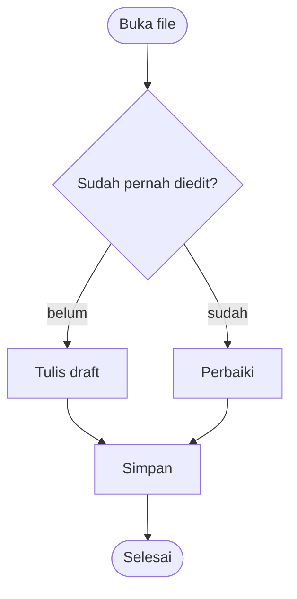

# Selamat datang di Markdown Studio

**Editor Markdown dengan pratinjau langsung** yang sepenuhnya bekerja offline. Tanpa
internet, tanpa akun — Anda menulis di sebelah kiri dan melihat hasil jadinya di kanan.

> [!TIP]
> Tombolnya sama dengan VS Code. Tekan <kbd>Ctrl</kbd>+<kbd>Shift</kbd>+<kbd>P</kbd> (atau
> <kbd>F1</kbd>) untuk mencari semua perintah, <kbd>Ctrl</kbd>+<kbd>P</kbd> untuk melompat ke berkas, dan
> <kbd>Ctrl</kbd>+<kbd>,</kbd> untuk Pengaturan. Halaman ini hilang? **Menu ⋮ → Panduan
> selamat datang** membuka versi terbarunya.

## Mulai cepat

1. Ketik di panel kiri — pratinjau berubah seiring Anda menulis
2. Pakai toolbar atau pintasan seperti <kbd>Ctrl</kbd>+<kbd>B</kbd> untuk **tebal**
3. Ambil screenshot (<kbd>Win</kbd>+<kbd>Shift</kbd>+<kbd>S</kbd>) lalu tekan
   <kbd>Ctrl</kbd>+<kbd>V</kbd> di editor — gambarnya masuk di posisi kursor
4. Buka satu folder utuh dengan <kbd>Ctrl</kbd>+<kbd>K</kbd> <kbd>Ctrl</kbd>+<kbd>O</kbd><!-- exe -->, atau
   klik kanan file `.md` di Windows → **Open with** → **Markdown Studio**<!-- /exe -->
5. Tekan <kbd>Ctrl</kbd>+<kbd>S</kbd> untuk menyimpan

**Halaman ini terdiri dari empat bagian.** Yang pertama adalah tur fitur aplikasi. Tiga
lainnya adalah panduan praktis menulis README: setiap contoh hidup, jadi baca hasilnya
di kanan dan lihat tempat yang sama di kiri untuk tahu persis cara mengetiknya. Hapus
bagian mana pun kalau sudah tidak perlu.

- [Bagian 0: Menggunakan Markdown Studio](#bagian-0-menggunakan-markdown-studio)
- [Bagian 1: Dasar-dasar](#bagian-1-dasar-dasar)
- [Bagian 2: Lebih jauh](#bagian-2-lebih-jauh)
- [Bagian 3: README yang layak dibaca](#bagian-3-readme-yang-layak-dibaca)

---

# Bagian 0: Menggunakan Markdown Studio

## Dua jenis dokumen

Sidebar di kiri punya empat panel, dipilih lewat ikon di bagian atasnya.

| Panel | Isinya |
| ----- | ------ |
| **Explorer** | Folder yang Anda buka, dalam bentuk pohon — semua file Markdown di dalamnya, ditambah seluruh isi folder `assets` |
<!-- exe -->
| **Docs** | Dokumen Anda sendiri, masing-masing berupa file `.md` sungguhan di folder dokumen Anda |
<!-- /exe -->
<!-- web -->
| **Docs** | Dokumen Anda sendiri, disimpan di browser ini |
<!-- /web -->
| **Outline** | Judul-judul di file yang sedang dibuka; klik salah satu untuk melompat ke sana |
| **Search** | Mencari di semua file dalam folder yang dibuka sekaligus |

<!-- exe -->
**Docs tersimpan sendiri.** Setiap dokumen di panel Docs adalah file di
`Documents\Markdown Studio`, ditulis seiring Anda mengetik. Ganti namanya lewat kotak
judul di atas dan nama file-nya ikut berganti; hapus dokumennya dan file-nya masuk ke
Recycle Bin. **Pengaturan → Change folder…** memindahkan semuanya ke tempat lain.
<!-- /exe -->
<!-- web -->
**Docs tersimpan sendiri, di browser ini.** Dokumen tetap ada saat Anda kembali, tapi
hanya di browser ini di komputer ini, dan ikut terhapus kalau data situsnya dibersihkan.
Tekan <kbd>Ctrl</kbd>+<kbd>S</kbd> untuk menyimpannya sebagai file `.md` sungguhan, atau
**⋮ → Download backup** untuk menyimpan salinan semuanya.
<!-- /web -->

**File dari folder Anda simpan sendiri**, seperti di VS Code. File yang diubah ditandai
titik oranye di tab dan di pohon, dan status bar menulis *Unsaved changes* sampai Anda
menekan <kbd>Ctrl</kbd>+<kbd>S</kbd> (<kbd>Ctrl</kbd>+<kbd>K</kbd> <kbd>S</kbd>
menyimpan semua file yang terbuka). Menutup tab yang belum disimpan akan ditanyakan
dulu.

<!-- web -->
> [!NOTE]
> Folder yang dibuka dari halaman yang dimuat langsung dari disk (alamatnya diawali
> `file://`) bersifat **read-only**, dan <kbd>Ctrl</kbd>+<kbd>S</kbd> akan mengunduh
> salinannya. Jalankan halaman ini lewat web server lokal, seperti laragon, supaya file
> bisa diedit di tempatnya.
<!-- /web -->

## Tab

Setiap file yang dibuka mendapat tab di bagian atas. <kbd>Alt</kbd>+<kbd>1</kbd>–<kbd>9</kbd>
melompat ke sebuah tab, <kbd>Ctrl</kbd>+<kbd>PageDown</kbd>/<kbd>PageUp</kbd> berpindah
satu per satu, klik tengah atau <kbd>Ctrl</kbd>+<kbd>W</kbd> menutup satu tab,
<kbd>Ctrl</kbd>+<kbd>K</kbd> <kbd>Ctrl</kbd>+<kbd>W</kbd> menutup semuanya, dan
<kbd>Ctrl</kbd>+<kbd>Shift</kbd>+<kbd>T</kbd> membuka lagi tab yang terakhir ditutup.
Klik kanan sebuah tab untuk Tutup yang lain, Salin Tab, Salin lokasi, dan Ganti nama.

**Pindahkan tab** seperti di Chrome: seret tab di sepanjang bar lalu lepaskan di tempat
yang Anda mau; tab lain bergeser memberi tempat. <kbd>Ctrl</kbd>+<kbd>Shift</kbd>+<kbd>PageUp</kbd>/<kbd>PageDown</kbd>
memindahkan tab yang sedang dibuka satu langkah ke kiri atau ke kanan, dan <kbd>Esc</kbd>
saat menyeret mengembalikan semuanya.

**Pindahkan lokasi penyimpanan dokumen** dengan menyeret tab-nya keluar dari bar:
- ke **folder di Explorer** — filenya pindah ke folder itu (dilepas di atas file, masuk
  ke folder file tersebut). Doc yang dilepas di sana keluar dari Docs dan menjadi file
  di folder itu
- ke panel **Docs** atau tombolnya — filenya menjadi Doc

Folder yang sedang dilewati menyala dan label menunjukkan tujuannya; tahan tab di atas
folder yang tertutup untuk membukanya, atau di atas tombol Explorer/Docs untuk berpindah
panel. Tab tetap di posisinya di bar dan langsung menampilkan file di lokasi barunya.
Gambar tetap tampil: tautannya disesuaikan ke lokasi baru, dan gambar dari folder lain
ikut disalin. Kalau dokumen lain menautkan ke file itu, Anda ditanya apakah tautannya
ikut diperbarui, seperti setelah ganti nama.
<!-- exe -->
File lamanya masuk ke Recycle Bin.
<!-- /exe -->

**Salin tab:** klik kanan tab → **Salin Tab**, lalu klik kanan bagian kosong di bar tab →
**Tempel Tab**. Muncul tab baru dengan isi yang sama, bernama "… (salinan)". Salinan
ini **dokumen baru yang disimpan di lokasi baru**, bukan file yang sama — mengedit
salinan tidak pernah mengubah aslinya:
<!-- exe -->
- salinannya adalah Doc, disimpan sebagai file `.md` sendiri di folder dokumen
  (`Documents\Markdown Studio`), dan tampil di panel Docs
- gambar yang ditampilkan aslinya dari folder `assets`-nya ikut disalin ke `assets` di
  folder dokumen, dan tautan di salinan diarahkan ke sana, jadi gambarnya tetap tampil
<!-- /exe -->
<!-- web -->
- salinannya adalah Doc, disimpan di penyimpanan browser ini dan tampil di panel Docs
- gambar yang ditampilkan aslinya dari foldernya dimasukkan ke dalam teks salinan,
  jadi tetap tampil tanpa folder itu
<!-- /web -->

> [!NOTE]
> Beberapa tombol milik browser dan tidak pernah sampai ke halaman: <kbd>Ctrl</kbd>+<kbd>W</kbd>,
> <kbd>Ctrl</kbd>+<kbd>N</kbd>, <kbd>Ctrl</kbd>+<kbd>Tab</kbd> dan
> <kbd>Ctrl</kbd>+<kbd>Shift</kbd>+<kbd>T</kbd> bisa saja menutup atau membuka jendela.
> Masing-masing punya tombol kedua yang selalu berfungsi — <kbd>Ctrl</kbd>+<kbd>Alt</kbd>+<kbd>W</kbd>,
> <kbd>Alt</kbd>+<kbd>N</kbd>, <kbd>Ctrl</kbd>+<kbd>Alt</kbd>+<kbd>→</kbd> — tercantum di
> lembar pintasan (<kbd>Ctrl</kbd>+<kbd>K</kbd> <kbd>Ctrl</kbd>+<kbd>S</kbd>).

## Klik kanan, ganti nama, dan hapus

Klik kanan sebuah berkas di Explorer untuk menu ala VS Code: **Buka**, **Tampilkan di File
Explorer**, **Salin lokasi**, **Salin lokasi relatif**, **Ganti nama…** dan **Hapus**.
Gambar dan berkas lain di folder `assets` juga punya menu ini, ditambah **Sisipkan ke
dokumen**; folder punya **Berkas baru…**; dokumen di panel Docs dan tab editor punya
menunya sendiri.

**Ganti nama** dilakukan langsung di pohon, dengan nama terpilih sampai sebelum
ekstensinya, seperti di VS Code: ketik, lalu <kbd>Enter</kbd> untuk menyimpan atau
<kbd>Esc</kbd> untuk membatalkan. Klik sebuah berkas sekali lalu <kbd>F2</kbd> untuk
mengganti nama, <kbd>Delete</kbd> untuk menghapus. Kalau dokumen lain menautkan ke berkas
yang Anda ganti namanya, Anda akan ditanya apakah tautan itu ikut diperbarui — termasuk
gambar, jadi `` mengikuti `lama.png` ke nama barunya.

<!-- exe -->
**Hapus** mengirim berkas ke Recycle Bin, jadi salah klik masih bisa dibatalkan dari sana.
<!-- /exe -->
<!-- web -->
**Hapus** di folder yang dibuka lewat browser menghapus berkas selamanya — browser tidak
punya Recycle Bin — dan hal itu disebutkan sebelum dihapus.
<!-- /web -->

## Gambar

**Tempel screenshot langsung**, seperti di Word:

1. Tekan <kbd>Win</kbd>+<kbd>Shift</kbd>+<kbd>S</kbd> lalu pilih bagian layar
   (atau salin gambar apa saja)
2. Klik di editor, di tempat gambar akan diletakkan
3. Tekan <kbd>Ctrl</kbd>+<kbd>V</kbd>

Gambarnya disimpan sebagai file sungguhan di **folder `assets` di sebelah dokumen**,
dinamai sesuai nama dokumen dan waktunya, dan baris seperti ini dimasukkan di barisnya
sendiri:

````markdown

````

Lalu ganti kata `image` dengan apa yang sebenarnya ditunjukkan gambar itu — lihat
[Tautan dan gambar](#tautan-dan-gambar) untuk alasannya.

- **Seret file gambar** ke jendela untuk hasil yang sama; namanya tetap seperti aslinya
- Nama yang sudah dipakai **tidak pernah ditimpa** — gambar baru diberi nomor
- Menyalin sel dari Excel atau teks dari Word tetap menempelkan **teksnya**, walaupun
  program itu juga menaruh gambar di clipboard
- Kalau tidak ada folder untuk menyimpan (dokumen yang hanya ada di browser, atau folder
  read-only), gambarnya **disematkan** ke dalam dokumen: di tempat Anda menempel tertulis
  `![image][img-1]` dan data gambarnya ada di paling bawah file
- **Export HTML** memasukkan semua gambar ke dalam file hasil export, jadi bisa dibuka
  di mana saja

| Lokasi dokumen | Lokasi gambarnya |
| -------------- | ---------------- |
| `D:\Proyek\catatan.md` | `D:\Proyek\assets\` |
| `D:\Proyek\docs\api.md` | `D:\Proyek\docs\assets\` |
<!-- exe -->
| Dokumen di panel Docs | `Documents\Markdown Studio\assets\` |
<!-- /exe -->

> [!IMPORTANT]
> Tautannya relatif, jadi dokumen dan folder `assets`-nya satu paket. Salin atau pindahkan
> keduanya bersama-sama dan gambarnya tetap tampil — di aplikasi ini, di VS Code, dan di
> GitHub.

## Isi folder `assets`

Explorer **hanya menampilkan file Markdown** — kecuali di dalam folder bernama `assets`,
yang menampilkan **semuanya**, supaya Anda tahu apa saja isinya.

| File | Di pohon | Kalau diklik |
| ---- | -------- | ------------ |
| `.png` `.jpg` `.jpeg` `.gif` `.webp` `.bmp` `.svg` `.avif` `.ico` | ikon gambar | gambarnya, ukurannya dalam piksel dan di disk, serta lokasinya |
| jenis lain (`.pdf`, `.docx`, `.zip`, ...) | ikon file | nama dan lokasinya |

Dari jendela itu, **Salin lokasi** menyalin letak file-nya, dan **Sisipkan ke dokumen**
menulis tautan yang benar ke dokumen yang sedang Anda edit — ``
dari subfolder, atau `[spec.pdf](assets/spec.pdf)` untuk file yang bukan gambar. Tombol
ini hanya aktif kalau dokumennya ada di folder yang sama, karena hanya dengan begitu
tautannya akan berfungsi.

<!-- exe -->
Panel **Docs** menampilkan isi folder `assets` milik library di bawah daftar dokumen.
Masing-masing menyebut dokumen yang memakainya, dan yang **tidak dipakai dokumen mana
pun** ditandai oranye — tanda bahwa file itu mungkin sudah bisa dihapus.
<!-- /exe -->

Mengklik tautan gambar di pratinjau membuka jendela yang sama.

## Mencari sesuatu

| Untuk | Tekan |
| ----- | ----- |
| Melompat ke berkas menurut nama | <kbd>Ctrl</kbd>+<kbd>P</kbd> |
| Menjalankan perintah apa pun | <kbd>Ctrl</kbd>+<kbd>Shift</kbd>+<kbd>P</kbd> atau <kbd>F1</kbd> |
| Melompat ke sebuah judul | <kbd>Ctrl</kbd>+<kbd>Shift</kbd>+<kbd>O</kbd>, atau panel **Outline** |
| Ke baris tertentu | <kbd>Ctrl</kbd>+<kbd>G</kbd> |
| Cari / ganti di file ini | <kbd>Ctrl</kbd>+<kbd>F</kbd> / <kbd>Ctrl</kbd>+<kbd>H</kbd> |
| Cari di semua file dalam folder | <kbd>Ctrl</kbd>+<kbd>Shift</kbd>+<kbd>F</kbd> |

<kbd>Ctrl</kbd>+<kbd>P</kbd> memakai awalan yang sama dengan VS Code: mulai dengan `>`
untuk perintah, `@` untuk judul, `:` untuk nomor baris.

Pencarian menyorot semua hasil, membingkai hasil yang aktif dan menggulir ke sana;
<kbd>Enter</kbd> berpindah ke hasil berikutnya. Ada mode peka huruf besar-kecil dan
regex, dan bisa dipakai di pratinjau juga — mencocokkan teks seperti yang terbaca, bukan
Markdown-nya. Cari di folder mengelompokkan hasil per file — klik salah satu untuk
membuka file itu tepat di barisnya.

## Tampilan

<kbd>Ctrl</kbd>+<kbd>1</kbd> editor saja, <kbd>Ctrl</kbd>+<kbd>2</kbd> berdampingan,
<kbd>Ctrl</kbd>+<kbd>3</kbd> pratinjau saja. Berpindah tampilan tidak menghilangkan
posisi Anda. Seret garis di antara kedua panel untuk mengubah ukurannya, klik dua kali
untuk mengembalikannya ke tengah.

Saat berdampingan, kedua panel menggulir bersama, dan **memilih teks di editor menyorot
blok yang sama di pratinjau** — berguna untuk tahu sedang di bagian mana dari dokumen
yang panjang. Keduanya bisa dimatikan di Pengaturan.

## Picture-in-picture

Seperti jendela mengambang di Google Meet: jendela kecil yang selalu tampil di atas
aplikasi lain, berisi dokumen yang sedang Anda buka. Nyalakan di **Pengaturan → Jendela →
Picture-in-picture**, lalu buka lewat tombol yang muncul di bar atas atau
<kbd>Ctrl</kbd>+<kbd>Alt</kbd>+<kbd>P</kbd>.

- **Pratinjau** menampilkan hasil jadinya dan mengikuti apa yang Anda ketik; centang tugas
  di sana dan dokumennya ikut tercentang
- **Edit** mengubahnya menjadi editor kecil — terus menulis catatan sementara rapat,
  browser, atau spreadsheet memenuhi layar. Tulisan masuk ke dokumen yang sama, jadi
  menyimpan dan simpan otomatis tetap berjalan, dan <kbd>Ctrl</kbd>+<kbd>S</kbd> berfungsi
  di dalamnya
- Berpindah antara Pratinjau dan Edit tetap di posisi yang sama: sudah scroll setengah di
  satu mode, mode lainnya juga terbuka di paragraf yang sama
- Ganti dokumen di aplikasi dan jendela ini ikut; tombol ↩ membawa Anda kembali dan
  menutupnya
<!-- exe -->
- Jendela ini menyatu dengan aplikasi: judulnya Markdown Studio, hanya ada satu Markdown
  Studio di Alt+Tab dan di taskbar, bukan dua, dan tetap tampil saat jendela utama
  diminimalkan. Tombol minimize-nya menutup jendela ini — buka lagi lewat tombolnya
<!-- /exe -->
<!-- web -->
Butuh Edge atau Chrome 116 ke atas. Membukanya selalu butuh klik atau tombol: browser
hanya mengizinkan panggilan video membukanya sendiri.
<!-- /web -->

## Tautan antar-file

Klik tautan ke file Markdown lain di pratinjau — `[catatan](catatan.md)`,
`[naik](../README.md)`, `[pemasangan](panduan.md#instalasi)` — dan file itu terbuka
sebagai tab, bukan meninggalkan halaman. Ini berlaku setelah foldernya dibuka.

## Membagikan tulisan

Semuanya ada di **menu ⋮** di kanan atas:

| Menu | Hasilnya |
| ---- | -------- |
| Export HTML | Satu file `.html` berisi gaya tampilan dan gambarnya, untuk dikirim ke siapa saja |
| Print / PDF | Pratinjau dicetak atau disimpan sebagai PDF |
| Copy HTML | HTML hasil render di clipboard, untuk ditempel di halaman web |
| Download backup | Semua dokumen di panel Docs dalam satu file `.json` |
| Import backup | Mengembalikan dokumen-dokumen itu |

## Pengaturan

<kbd>Ctrl</kbd>+<kbd>,</kbd> membukanya: <!-- exe -->lokasi dokumen Anda, <!-- /exe -->soft wrap, sinkronisasi
gulir, tata letak lebar, kedua ukuran teks, mode gelap
(<kbd>Ctrl</kbd>+<kbd>K</kbd> <kbd>Ctrl</kbd>+<kbd>T</kbd>), bahasa — **Bahasa Indonesia** atau
English — dan picture-in-picture.

## Tombol, seperti di VS Code

Kalau tangan Anda sudah hafal VS Code, aplikasi ini terasa sama. Tombol menyuntingnya milik
VS Code, dan tombol formatnya milik ekstensi *Markdown All in One*:

| Menyunting | Tekan | Format | Tekan |
| ---------- | ----- | ------ | ----- |
| Pilih kata, lalu kemunculan berikutnya | <kbd>Ctrl</kbd>+<kbd>D</kbd> | Tebal / miring | <kbd>Ctrl</kbd>+<kbd>B</kbd> / <kbd>Ctrl</kbd>+<kbd>I</kbd> |
| Pilih baris | <kbd>Ctrl</kbd>+<kbd>L</kbd> | Coret | <kbd>Alt</kbd>+<kbd>S</kbd> |
| Hapus baris | <kbd>Ctrl</kbd>+<kbd>Shift</kbd>+<kbd>K</kbd> | Judul lebih besar / kecil | <kbd>Ctrl</kbd>+<kbd>Shift</kbd>+<kbd>]</kbd> / <kbd>[</kbd> |
| Pindahkan baris | <kbd>Alt</kbd>+<kbd>↑</kbd>/<kbd>↓</kbd> | Centang/batal tugas | <kbd>Alt</kbd>+<kbd>C</kbd> |
| Salin baris ke atas / bawah | <kbd>Shift</kbd>+<kbd>Alt</kbd>+<kbd>↑</kbd>/<kbd>↓</kbd> | Kode sebaris | <kbd>Ctrl</kbd>+<kbd>`</kbd> |
| Baris baru di bawah / atas | <kbd>Ctrl</kbd>+<kbd>Enter</kbd> / <kbd>Ctrl</kbd>+<kbd>Shift</kbd>+<kbd>Enter</kbd> | Jadikan komentar | <kbd>Ctrl</kbd>+<kbd>/</kbd> |
| Jorokkan / kurangi jorokan | <kbd>Ctrl</kbd>+<kbd>]</kbd> / <kbd>[</kbd> | Buka/tutup pratinjau | <kbd>Ctrl</kbd>+<kbd>Shift</kbd>+<kbd>V</kbd> |

<kbd>Ctrl</kbd>+<kbd>C</kbd> dan <kbd>Ctrl</kbd>+<kbd>X</kbd> tanpa pilihan menyalin atau
memotong seluruh baris. Tempel URL di atas kata yang dipilih dan kata itu menjadi tautan.
<kbd>Ctrl</kbd>+<kbd>B</kbd> berarti tebal saat mengetik dan membuka/menutup panel samping
di tempat lain. <kbd>Ctrl</kbd>+<kbd>K</kbd> memulai kombinasi dua tombol, seperti di
VS Code — status bar memberi tahu saat menunggu tombol kedua.

---

# Bagian 1: Dasar-dasar

## Judul

Satu `#` per tingkat, lalu spasi setelah tanda pagar. Beri setiap file **satu** judul `#`
dan letakkan yang lain di bawahnya.

````markdown
# Judul proyek      (satu per file)
## Sebuah bagian
### Sub-bagian
````

Setiap judul diam-diam menjadi target tautan, dan itulah yang membuat daftar isi
mungkin dibuat — dijelaskan di Bagian 2.

## Paragraf dan baris baru

Baris kosong memulai paragraf baru. Enter biasa **tidak** memutus baris — teksnya tetap
mengalir, dan biasanya memang itu yang diinginkan. Untuk memaksa baris baru di dalam satu
paragraf, akhiri barisnya dengan garis miring terbalik. (Dua spasi di akhir baris juga
bisa dan sering terlihat di file orang lain, tapi sintaks yang tak terlihat mudah hilang
oleh editor yang memangkas spasi.)

````markdown
Dua baris ini
menjadi satu baris.

Yang ini putus \
tepat di sini.
````

Dua baris ini
menjadi satu baris.

Yang ini putus \
tepat di sini.

## Penekanan dan tanda dalam teks

| Anda ketik | Hasilnya |
| ---------- | -------- |
| `**tebal**` | **tebal** |
| `*miring*` | *miring* |
| `***keduanya***` | ***keduanya*** |
| `~~dicoret~~` | ~~dicoret~~ |
| `` `kode` `` | `kode` |
| `==disorot==` | ==disorot== |
| `H~2~O` | H~2~O |
| `x^2^` | x^2^ |

Pakai `` ` `` untuk apa pun yang mungkin salah diketik pembaca: nama file, opsi, perintah,
nilai. Di README, itu lebih penting daripada huruf tebal.

## Daftar

Menjorok dua spasi untuk membuat sub-daftar. Daftar bernomor menomori dirinya sendiri,
jadi Anda bisa menulis `1.` di setiap baris selama menyusun draf dan hasilnya tetap
berurutan.

````markdown
- Daftar tanpa nomor
- Struktur bertingkat
  - Satu tingkat lebih dalam
  - Dan satu lagi

1. Daftar bernomor
2. Menghitung sendiri
3. Secara otomatis
````

- Daftar tanpa nomor
- Struktur bertingkat
  - Satu tingkat lebih dalam
  - Dan satu lagi

1. Daftar bernomor
2. Menghitung sendiri
3. Secara otomatis

Untuk menaruh blok kode atau paragraf **di dalam** butir daftar, buat menjorok sejajar
dengan teks butirnya:

1. Pasang dulu:

   ```shell
   npm install my-package
   ```

2. Lalu jalankan. Jorokan itulah yang membuat langkah ini tetap menempel di butir 2.

## Tautan dan gambar

````markdown
[teks tautan](https://example.com)
[dengan tooltip](https://example.com "Muncul saat kursor di atasnya")

<https://example.com>
````

[teks tautan](https://example.com)
[dengan tooltip](https://example.com "Muncul saat kursor di atasnya")
<https://example.com>

| Anda ketik | Fungsinya |
| ---------- | --------- |
| `[teks tautan](https://example.com)` | Menampilkan **teks tautan**; kalau diklik membuka alamat di dalam `( )` |
| `[teks](https://example.com "Muncul saat kursor di atasnya")` | Sama, ditambah tooltip saat kursor di atasnya |
| `<https://example.com>` | Alamatnya sendiri, dijadikan bisa diklik |
| `` | **Menampilkan gambar** di lokasi itu |

**Gambar adalah tautan dengan `!` di depannya.** Teks di dalam `[ ]` adalah *teks alt*:
yang dibacakan pembaca layar untuk orang yang tidak bisa melihatnya, dan yang tampil
kalau file-nya hilang. Jadi tulis apa yang ditunjukkan gambar, bukan bahwa itu gambar:

````markdown
                              <- tidak menjelaskan apa-apa
      <- menjelaskan isinya
````

Lokasinya **relatif terhadap dokumen**: `assets/shot.png` adalah folder `assets` di
sebelah file ini, `../assets/shot.png` adalah satu folder di atasnya. Anda jarang perlu
mengetiknya sendiri — tempel screenshot dan barisnya ditulis otomatis (lihat
[Gambar](#gambar)).

Tautan ke **file Markdown lain bisa dipakai di sini**: `[panduan](docs/panduan.md)`
membuka file itu sebagai tab, bukan meninggalkan halaman, selama foldernya sudah dibuka.
Tambahkan id judul untuk langsung menuju ke sana: `[instalasi](docs/panduan.md#instalasi)`.

## Kode

Kode dalam baris untuk hal pendek. Blok berpagar untuk apa pun yang akan disalin orang —
dan selalu sebutkan bahasanya, karena itulah yang menyalakan pewarnaan sintaks.

````markdown
```js
const sapa = (nama = "dunia") => `Halo, ${nama}!`;
```
````

```js
// Sekitar 25 bahasa dikenali
const sapa = (nama = "dunia") => {
  const waktu = Date.now();
  return `Halo, ${nama}! (${waktu})`;
};
console.log(sapa("Markdown"));
```

```python
def fib(n: int) -> list[int]:
    """Deret klasik, iteratif."""
    out, a, b = [], 0, 1
    for _ in range(n):
        out.append(a)
        a, b = b, a + b
    return out
```

```shell
# shell, sql, json, yaml, html, css, go, rust, java dan lainnya juga bisa
git clone https://example.com/project.git && cd project
```

## Kutipan

> Kutipan biasa untuk catatan sampingan.
> Bisa lebih dari satu baris.
>
> > Dan bisa bertingkat, kalau memang perlu.

## Tabel

Baris judul dan baris garis-garis wajib ada. Titik dua di baris garis menentukan
perataan: kiri, `:-:` tengah, `-:` kanan.

````markdown
| Fitur | Pintasan | Bisa offline |
| ----- | :------: | -----------: |
| Tebal | `Ctrl+B` |           Ya |
````

| Fitur             | Pintasan       | Bisa offline |
| ----------------- | :------------: | -----------: |
| Tebal             | `Ctrl+B`       |           Ya |
| Tautan            | `Ctrl+K`       |           Ya |
| Cari dan ganti    | `Ctrl+F`       |           Ya |
| Export HTML       | menu           |           Ya |

Garis tegaknya tidak harus sejajar — itu hanya supaya nyaman dibaca saat mengedit.
Untuk menulis `|` di dalam sel, tulis sebagai `\|`.

## Garis pemisah

Tiga tanda hubung atau lebih di barisnya sendiri. Berguna di antara bagian besar README
yang panjang, tapi mudah berlebihan.

---

# Bagian 2: Lebih jauh

## Callout

Lima jenis, tampil sebagai panel berwarna. Pakai ini daripada menulis **Catatan:** dengan
huruf tebal.

````markdown
> [!NOTE]
> Konteks berguna yang perlu diketahui pembaca.
````

> [!NOTE]
> Konteks berguna yang perlu diketahui pembaca.

> [!TIP]
> Jalan pintas atau cara yang lebih baik.

> [!IMPORTANT]
> Sesuatu yang tidak boleh dilewati.

> [!WARNING]
> Sesuatu yang bisa salah.

> [!CAUTION]
> Sesuatu yang akibatnya sulit dibatalkan.

## Daftar tugas

- [x] Kotak centangnya bisa diklik
- [x] Mengkliknya mengubah sumbernya untuk Anda
- [ ] Berguna untuk bagian roadmap

## Diagram

Blok kode bertanda `mermaid` digambar, bukan dicetak sebagai teks. Khusus flowchart —
`flowchart` atau `graph`, dengan arah `TD` (ke bawah), `LR`, `RL` atau `BT`.



Bar di bawah diagram punya **Code** untuk membaca sumbernya, **Copy** untuk menyalinnya,
serta **PNG** / **SVG** untuk menyimpan gambarnya.

Bentuk kotak ditentukan oleh kurung di sekitar label, garis penghubung oleh tanda hubung
di antaranya:

| Anda tulis | Hasilnya |
| ---------- | -------- |
| `A[Teks]` `A(Teks)` `A([Teks])` | kotak, sudut bulat, kapsul |
| `A[[Teks]]` `A[(Teks)]` `A((Teks))` | subrutin, database, lingkaran |
| `A{Teks}` `A{{Teks}}` `A[/Teks/]` | keputusan, segi enam, jajaran genjang |
| `A --> B` `A --- B` | panah, garis polos |
| `A -.-> B` `A ==> B` | putus-putus, tebal |
| `A -- ya --> B` `A -->|ya| B` | label pada garis |
| `A --> B & C` | keduanya, dari satu baris |

`subgraph Nama` ... `end` menggambar kotak di sekitar sekelompok node, `%%` memulai
komentar, dan `classDef`/`style` memberi warna. Diagram yang berputar kembali ke dirinya
sendiri juga tidak masalah.

## Catatan kaki

Pindahkan keterangan yang berat keluar dari kalimat[^kenapa] dan biarkan terkumpul di
bawah.

[^kenapa]: Seperti ini. Penandanya boleh label apa saja — `[^kenapa]`, `[^1]` — dan
urutannya di hasil mengikuti urutan dirujuk, bukan urutan ditulis.

## Bagian yang bisa dilipat

Output panjang, log lengkap, dan detail yang jarang dibutuhkan sebaiknya dilipat.

<details>
<summary>Klik untuk membuka</summary>

Sebagian HTML yang aman didukung, jadi <b>details</b>, <kbd>kbd</kbd> dan
<mark>mark</mark> semuanya bisa. Beri satu baris kosong setelah summary dan Anda bisa
memakai Markdown biasa di sini:

- termasuk daftar
- dan `kode`

</details>

## Tautan gaya referensi

Kalau tautan yang sama muncul berkali-kali, atau URL-nya terlalu panjang sampai merusak
kalimat, definisikan sekali di bawah. Tulisannya tetap enak dibaca, dan URL yang pindah
cukup diperbaiki di satu tempat.

````markdown
Lihat [dokumentasi][d] dan [catatan perubahan][c].

[d]: https://example.com/docs
[c]: https://example.com/changelog
````

Badge hanyalah tautan referensi dengan gambar di dalamnya — deretan badge ala shields.io
di bagian atas kebanyakan README tidak lebih dari ini.

## Anchor dan daftar isi

Setiap judul mendapat id dari teksnya: huruf kecil semua, tanda baca dibuang, spasi
diganti tanda hubung. `## Mulai cepat` menjadi `#mulai-cepat`. Judul yang berulang
diberi tambahan `-1`, `-2`.

````markdown
- [Mulai cepat](#mulai-cepat)
- [Lebih jauh](#bagian-2-lebih-jauh)
````

Hanya itu daftar isi. Layak ditambahkan begitu README melewati kira-kira dua layar.

> [!NOTE]
> Karakter di luar ASCII biasa tetap ikut ke dalam id — judul yang memakai tanda pisah
> panjang akan mempertahankannya. Klik sendiri tautan Anda di pratinjau sekali sebelum
> di-commit.

## Tombol, sorotan dan teks kecil

Tekan <kbd>Ctrl</kbd>+<kbd>S</kbd> untuk menyimpan. Tulis tombol sebagai
`<kbd>Ctrl</kbd>`, tonjolkan sesuatu dengan `==sorotan==`, dan pakai `H~2~O` serta
`x^2^` untuk subskrip dan superskrip.

## HTML di dalam Markdown

Berguna untuk satu hal yang tidak bisa dilakukan Markdown — biasanya blok judul di
tengah:

<div align="center">
  <b>Markdown Studio</b><br>
  <i>editor offline dalam satu file</i>
</div>

Skrip dan event handler dibuang, jadi README yang ditempel tidak bisa menjalankan apa
pun di sini.

## Escape dan komentar

Taruh garis miring terbalik di depan karakter untuk menampilkannya apa adanya:
`\*bukan miring\*` menghasilkan \*bukan miring\*. Hal yang sama berlaku untuk `` \` ``,
`\_`, `\#` dan `\|`.

Untuk meninggalkan catatan bagi diri sendiri yang tidak pernah dilihat pembaca, pakai
komentar HTML. Ada satu di baris berikut, dan hasilnya tidak tampil sama sekali.

<!-- TODO: jelaskan langkah deployment begitu sudah pasti -->

---

# Bagian 3: README yang layak dibaca

Orang yang membuka proyek Anda menanyakan tiga hal, berurutan: **ini apa, apakah ini
menyelesaikan masalah saya, dan bagaimana cara mulainya?** Jawab ketiganya di layar
pertama, dan sisanya boleh sepanjang yang diperlukan.

## Kerangka untuk memulai

````markdown
# Nama proyek

Satu kalimat tentang apa fungsinya dan untuk siapa.

## Instalasi

```shell
npm install nama-proyek
```

## Penggunaan

Contoh terkecil yang benar-benar bisa dijalankan.

## Konfigurasi

Tabel opsi, nilai bawaan, dan apa yang diubah masing-masing.

## Kontribusi

Cara menyiapkan lingkungan pengembangan dan apa yang Anda harapkan di pull request.

## Lisensi

MIT — lihat LICENSE.
````

## Yang membedakan README yang baik

- **Mulai dengan kalimat, bukan badge.** Orang harus tahu apakah perlu lanjut membaca
  sebelum menggulir.
- **Contoh pertama harus bisa dijalankan apa adanya.** Tanpa placeholder, tanpa import
  yang hilang, tanpa langkah yang "jelas" harus dilakukan duluan.
- **Sebutkan apa yang tidak bisa dilakukannya.** Batasan dan keterbatasan yang diketahui
  menghemat lebih banyak waktu daripada daftar fitur apa pun.
- **Tunjukkan output, bukan hanya perintah.** Blok berisi apa yang seharusnya mereka lihat
  lebih baik daripada paragraf yang menjelaskannya.
- **Pilih tabel** untuk apa pun yang punya lebih dari tiga opsi.
- **Lipat bagian yang panjang** dengan `<details>` daripada menghapusnya.
- **Tulis bagian instalasi paling akhir**, setelah Anda mengikuti langkah-langkah Anda
  sendiri di komputer yang bersih.

> [!TIP]
> Tekan <kbd>Ctrl</kbd>+<kbd>3</kbd> untuk pratinjau saja dan baca dari atas ke bawah
> seperti orang asing membacanya. Kebanyakan masalah README sudah terlihat dalam sepuluh
> detik.

---

Semua yang ada di sini boleh Anda hapus. Mulailah menulis.
